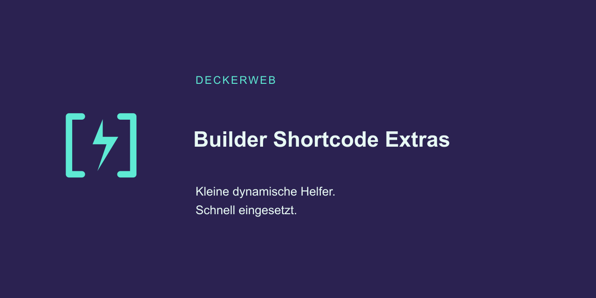

# Builder Shortcode Extras



**Kleine dynamische Helfer. Schnell eingesetzt.**

Copyright, Datumsangaben, Links und wiederverwendbare Inhalte ohne eigenes PHP. Mit einer durchsuchbaren Hilfe und einem kompakten Generator direkt in WordPress.

Version **1.3.0** · WordPress **6.7+** · PHP **8.0+** · GPL-2.0-or-later

[English](README.md) · [Anleitung und FAQ](https://github.com/deckerweb/builder-shortcode-extras/wiki/Deutsch) · [Download](https://github.com/deckerweb/builder-shortcode-extras/releases/latest)

## Inhalt

- [Auf einen Blick](#auf-einen-blick)
- [Installation und erste Schritte](#installation-und-erste-schritte)
- [Helfer für den Alltag](#helfer-für-den-alltag)
- [Beispiele](#beispiele)
- [Updates und Library](#updates-und-library)
- [Daten und Multisite](#daten-und-multisite)
- [FAQ](#faq)
- [Screenshots](#screenshots)
- [Changelog](#changelog)
- [Autor und Zweck](#autor-und-zweck)
- [Support und Sicherheit](#support-und-sicherheit)
- [Lizenz und Herkunft](#lizenz-und-herkunft)

## Auf einen Blick

- Durchsuchbare Shortcode-Hilfe direkt unter Werkzeuge → Builder Shortcode Extras.
- Neun Generatorfälle: Copyright, Daten, Links, Einbettung, Titel, Auszug, Bild und Lesezeit.
- Native Blöcke, synchronisierte Vorlagen und optionale Elementor-, Beaver-, Astra- und Genesis-Integrationen.
- Lokale Ressourcen, deutsche Du-/Sie-Texte und WordPress-Updates über GitHub.

## Installation und erste Schritte

1. Lade das Plugin-ZIP aus den GitHub-Releases herunter.
2. Öffne Plugins → Installieren → Plugin hochladen und aktiviere es.
3. Öffne Werkzeuge → Builder Shortcode Extras, wähle einen Helfer und kopiere den Shortcode.
4. Füge ihn in einen Shortcode-Block oder ein geeignetes Builder-Feld ein und prüfe die Ausgabe.

BSE speichert keine Generatorwerte und verändert keine Inhalte.

## Helfer für den Alltag

Copyright, Datumsangaben, Benutzerinformationen, Beitragslinks, Taxonomiebegriffe, Menüs und Kommentarformulare lassen sich gezielt einfügen. Viele Texthelfer unterstützen eigene CSS-Klassen und geprüfte HTML-Wrapper. Inhaltseinbettungen beachten Zugriffsrechte und unterbinden rekursive Verweise. Optionale Integrationen setzen den jeweiligen Builder beziehungsweise das Theme voraus.

Neue Helfer: `[bse-post-title]`, `[bse-post-excerpt words="30"]`, `[bse-post-image size="medium"]`, `[bse-reading-time wpm="200"]`. Mit `post_id` lassen sich Inhalte wählen; ohne ID gilt der aktuelle Frontend-Inhalt. Texthelfer unterstützen `wrapper="none"` und `fallback`. Veröffentlichungs-/Änderungsdaten bieten optional `semantic="true"`. Die lokale Inhaltssuche im Generator überträgt Suchbegriffe nur an diese WordPress-Website.

## Beispiele

```text
[bse-copyright first="2019"]
[bse-post-date format="Y-m-d"]
[bse-post-modified-date label="Last updated: "]
[bse-post-link id="123" text="Read more"]
[bse-item-content id="123"]
```

## Updates und Library

Der deckerweb Updater 2.1.0 prüft stabile GitHub-Releases über die normale WordPress-Updateverwaltung. Er aktiviert keine automatischen Updates. Die eingebettete deckerweb Library 0.9.0 ergänzt einen optionalen Katalog unter Plugins → Installieren → deckerweb. Ihre Online-Katalogabfrage ist standardmäßig ausgeschaltet. Installation und Aktivierung sind getrennte Entscheidungen. GitHub sieht bei Metadaten- oder Paketabrufen die anfragende IP-Adresse; BSE übermittelt keine Nutzungsdaten, Website-Adresse oder Benutzerkennungen.

## Daten und Multisite

BSE kann je Website oder netzwerkweit aktiviert werden. Inhalts-IDs gelten für die aktuelle Website. Website-Administratoren verwenden Werkzeuge → Builder Shortcode Extras; Super-Administratoren zusätzlich Netzwerkeinstellungen → Builder Shortcode Extras. Die Library-Optionen gelten je Netzwerk. BSE speichert keine Einstellungen. Deaktivierung erhält Daten; Deinstallation bereinigt den eigenen Updatecache. Library-Daten bleiben erhalten, solange ein weiterer Host installiert ist. Beim letzten Host werden temporäre Daten bereinigt; Optionen bleiben standardmäßig erhalten. Inhalte und installierte Plugins werden nicht gelöscht.

## FAQ

### Muss ich das Plugin konfigurieren?

Nein. Öffne Werkzeuge → Builder Shortcode Extras, um einen Shortcode zu finden oder zu erstellen. Die Seite speichert keine Einstellungen.

### Wo füge ich einen Shortcode ein?

In einen WordPress-Shortcode-Block oder ein Builder-Feld mit ausdrücklicher Shortcode-Unterstützung. Beliebige Text-, URL- und HTML-Felder führen Shortcodes nicht automatisch aus.

### Was kann der Generator erstellen?

Der Generator erstellt Copyright, Veröffentlichungs-/Änderungsdaten, Beitragslinks, eingebettete Inhalte, Titel, Auszüge, Beitragsbilder und Lesezeit. Weitere Helfer bleiben im durchsuchbaren Katalog.

### Kann ich HTML und Klassen ändern?

Die meisten Texthelfer unterstützen wrapper, class, before und after. Mehrere Klassen sind möglich. Unsichere oder nicht unterstützte Wrapper werden durch span ersetzt. Texthelfer bieten wrapper="none" und fallback; Einbettungen, Menüs, Kommentarformulare und Bilder behalten ihr eigenes HTML.

### Funktionieren synchronisierte Vorlagen mit Classic Editor?

bse-wpblock ist verfügbar, sobald WordPress den Inhaltstyp wp_block registriert. Das zusätzliche alte Blocks-Menü entfällt.

### Wie funktionieren die neuen Inhaltshelfer?

post_id wählt lesbare Inhalte; ohne Angabe gilt der aktuelle Frontend-Inhalt. Auszüge verwenden den manuellen Auszug oder gespeicherten Text, mit words zwischen 1 und 500. Bilder verwenden registrierte WordPress-Größen und natives responsives HTML. Die Lesezeit zählt gespeicherten Text ohne Ausführung eingebetteter Shortcodes; wpm ist auf 50–1000 begrenzt. Reines Builder-Markup und bildlastige Artikel können unvollständige Schätzungen ergeben.

### Was überträgt die Inhaltssuche?

Ab zwei Zeichen durchsucht der Generator die aktuelle Website über authentifiziertes WordPress-AJAX. Nonce und Administratorberechtigung sind erforderlich. Höchstens zehn lesbare Titel/IDs werden ausgegeben. Suchbegriffe gehen nicht an GitHub oder externe Dienste; bei Fehlern bleibt die manuelle ID-Eingabe möglich.

[Alle Fragen nach Themen](https://github.com/deckerweb/builder-shortcode-extras/wiki/Deutsch#fragen-nach-themen).

## Screenshots


## Changelog

## 1.3.0 — 2026-10-10

- **Verbessert:** Admin-Hinweise erscheinen hinter dem vollständigen Header; das Produkt-Icon wird ausschließlich im Header angezeigt.
- **Neu:** Shortcodes für Titel, Auszug, responsives Beitragsbild und geschätzte Lesezeit.
- **Neu:** Optionale Textausgabe ohne Wrapper, maskierte Fallback-Texte und semantische Datumsangaben.
- **Verbessert:** Neun Generatorfälle mit geschützter Inhaltssuche, klarerem Kontext des aktuellen Inhalts und erhaltenen Eingaben je Fall.
- **Behoben:** rel-Attribute an Links funktionieren ohne target; Menü-Shortcodes berücksichtigen die angegebene Container-ID.
- **Verbessert:** Neue Banner und abgerundete Plugin-Icons mit einem einheitlichen Motiv für wiederverwendbare Inhalte.
- **Sonstiges:** Eingebettete deckerweb Library auf 0.9.0 aktualisiert; bestehende Shortcode-Funktionen und Mindestanforderungen bleiben unverändert.

## 1.2.1 — 09.10.2026

- **Verbessert:** Weniger Aufwand im Frontend: Update- und Katalogkomponenten laden nur bei Bedarf; wiederholte Abfragen des Website-Änderungsdatums verwenden einen gemeinsamen Cache pro Anfrage.
- **Verbessert:** Verständlichere lokale Hilfe, zugängliche Changelog-Kennzeichnung und abgestimmte englische, deutsche und formell deutsche Dokumentation.
- **Behoben:** Versions-Shortcodes geben keine beliebigen Installationskonstanten mehr aus; Menü-Shortcodes können keine beliebigen PHP-Callbacks aus Inhalten aufrufen.
- **Behoben:** Links, Datumsangaben und Kommentarformulare zu privaten Inhalten beachten Zugriffsrechte; Beschriftungen, Taxonomie-Trennzeichen und Menüformatierung werden sicher verarbeitet.
- **Behoben:** Netzwerkverwaltung verwendet passende Berechtigungen und Einstellungen-Links; gemeinsame Deinstallation schützt andere Plugins und gemeinsam genutzte Library-Daten.
- **Behoben:** Update-Pakete werden auf angebotene Version, Plugin-Identität und tatsächliche WordPress-/PHP-Anforderungen geprüft, auch bei Sammelupdates.
- **Sonstiges:** deckerweb Library 0.8.1 und Updater 2.1.0 eingebunden. Bestehende Shortcode-Namen, Attribute, Entwicklerfilter und optionale Integrationen bleiben verfügbar.
- **Sonstiges:** Zweisprachige Readmes, FAQ, Grafiken und vertraulicher Sicherheitsmeldeweg aktualisiert. Voraussetzungen bleiben WordPress 6.7+ und PHP 8.0+.

## 1.2.0 — 01.10.2026

- **Neu:** Durchsuchbare Shortcode-Hilfe mit Kopierfunktion und lokalem Generator für Copyright, Veröffentlichungsdatum, Änderungsdatum, Beitragslinks und Inhaltseinbettung.
- **Neu:** deckerweb Plugin Library 0.2.0 und gemeinsamer deckerweb GitHub Release Updater v2 eingebunden.
- **Verbessert:** Einheitliche Wrapper-Prüfung, mehrere CSS-Klassen, boolesche Attribute und bereinigte Textausgabe; Shortcode-Namen, Aliase und Ausgabefilter bleiben erhalten.
- **Verbessert:** Native Blöcke werden gerendert; Builder werden passend zum Inhalt gewählt; direkte und indirekte rekursive Einbettung wird verhindert.
- **Verbessert:** Lokaler Änderungsverlauf und Dokumentation sowie deutsche und formell deutsche Übersetzungen.
- **Behoben:** Admin-Registrierung, Rückgabe bereinigter Integrationsdaten und versehentlich registrierter Platzhalter korrigiert.
- **Behoben:** Veröffentlichungsdatum berücksichtigt die Beitrags-ID; Slug-Links werden korrekt aufgelöst; ungültige IDs und unbekannte Zählstatus werden behandelt.
- **Behoben:** Nicht definierte Versionskonstanten, Datenbankversionsabfrage sowie Escaping von Benutzerwerten, Ersatztext, Datumsbeschriftungen, Linktext und Tooltip korrigiert.
- **Behoben:** Website-Änderungsdatum verwendet die WordPress-Zeitzone und liefert bei fehlenden veröffentlichten Inhalten kein falsches Datum.
- **Sonstiges:** Benötigt WordPress 6.7+ und PHP 8.0+; PHP 8.0 wird von der Library vorausgesetzt. Die Helfer-Oberfläche lädt keine Frontend-Ressourcen.
- **Sonstiges:** Genesis und Beaver bleiben erhalten; doppelter Astra-Loader, altes Blocks-Menü und sachfremde Werbe-/Core-Admin-Eingriffe entfernt.

## 1.1.0 — 2025-03-15

- **Verbessert:** Shortcode-Kompatibilität wiederhergestellt.
- **Sonstiges:** Verteilung von WordPress.org zu GitHub verlagert und alten DDWlib-Empfehlungsinstaller entfernt.
- **Sonstiges:** Eigenen Übersetzungsloader entfernt; mitgelieferte Übersetzungen beibehalten.

## 1.0.0 — 2019-09-10

- **Neu:** Erste Veröffentlichung mit 25 allgemeinen Helfern und 5 Integrations-Shortcodes.

## 0.9.0 — 2019-09-09

- **Neu:** Erste öffentliche Beta auf GitHub.

## Autor und Zweck

David Decker – DECKERWEB entwickelt und veröffentlicht dieses Plugin seit 2019. Es konzentriert sich auf kleine dynamische Helfer und wird direkt über GitHub verteilt. Die Builder-Integrationen sind optional; eine allgemeine Zertifizierung kommerzieller Builder wird nicht behauptet.

## Support und Sicherheit

[Issues](https://github.com/deckerweb/builder-shortcode-extras/issues) · [Discussions](https://github.com/deckerweb/builder-shortcode-extras/discussions) · [Security](https://github.com/deckerweb/builder-shortcode-extras/security/advisories/new)

Sicherheitslücken bitte vertraulich melden. [Meldeweg](SECURITY.md). Unterstützung: [Ko-fi](https://ko-fi.com/deckerweb) · [Buy Me a Coffee](https://buymeacoffee.com/daveshine) · [PayPal](https://paypal.me/deckerweb).

## Lizenz und Herkunft

© 2019–2026 David Decker – DECKERWEB. [GPL v2 or later](https://www.gnu.org/licenses/gpl-2.0.html).

Mitgelieferte deckerweb Library und Updater: David Decker – DECKERWEB, GPL-2.0-or-later. Die BSE-Grafiken sind originale Vektorarbeiten mit Inter-Schriftpfaden (Copyright The Inter Project Authors, SIL Open Font License 1.1; Lizenz in assets/Inter-OFL.txt). Es werden keine Schriftdateien mitgeliefert. WordPress- und Builder-Namen gehören ihren jeweiligen Rechteinhabern.
