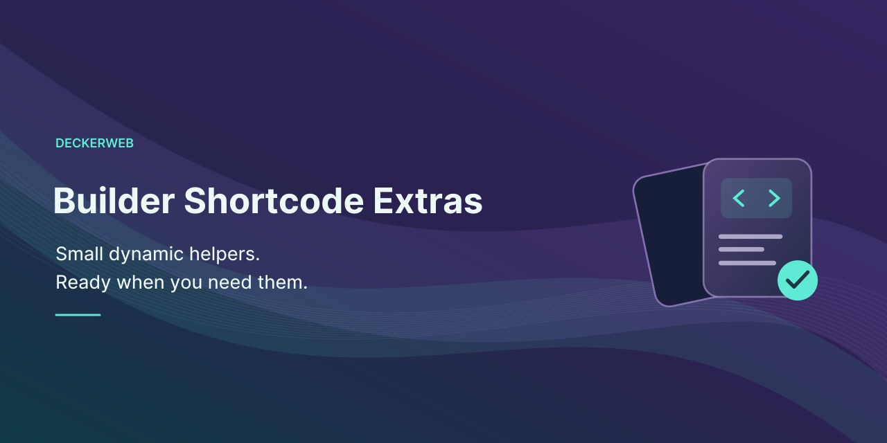
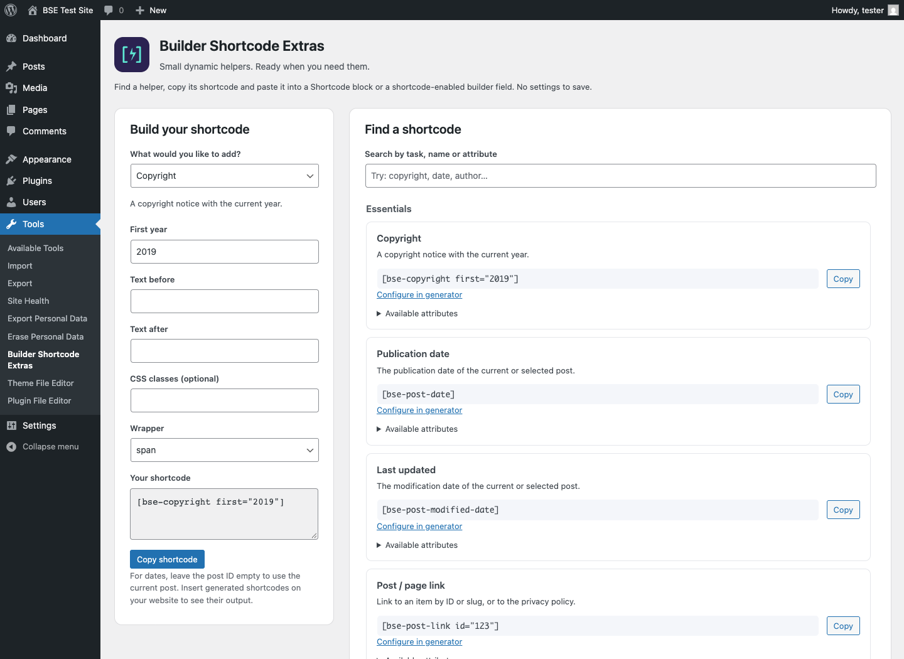

# Builder Shortcode Extras



**Small dynamic helpers. Ready when you need them.**

Copyright, dates, links and reusable content without custom PHP. Includes searchable help and a compact generator directly in WordPress.

Version **1.3.0** · WordPress **6.7+** · PHP **8.0+** · GPL-2.0-or-later

[Deutsch](README-de.md) · [Guide and FAQ](https://github.com/deckerweb/builder-shortcode-extras/wiki/English) · [Download](https://github.com/deckerweb/builder-shortcode-extras/releases/latest)

## Contents

- [At a Glance](#at-a-glance)
- [Installation and first steps](#installation-and-first-steps)
- [Everyday helpers](#everyday-helpers)
- [Examples](#examples)
- [Updates and Library](#updates-and-library)
- [Data and Multisite](#data-and-multisite)
- [FAQ](#faq)
- [Screenshots](#screenshots)
- [Changelog](#changelog)
- [Author and scope](#author-and-scope)
- [Support and security](#support-and-security)
- [License and provenance](#license-and-provenance)

## At a Glance

- Searchable shortcode help under Tools → Builder Shortcode Extras.
- Nine generator cases: copyright, dates, links, embedding, title, excerpt, image and reading time.
- Native blocks, synced patterns and optional Elementor, Beaver, Astra and Genesis integrations.
- Local assets, informal/formal German translations and WordPress updates from GitHub.

## Installation and first steps

1. Download the plugin ZIP from GitHub Releases.
2. Open Plugins → Add New → Upload Plugin and activate it.
3. Open Tools → Builder Shortcode Extras, choose a helper and copy its shortcode.
4. Paste it into a Shortcode block or supported builder field and check its output.

BSE saves no generator values and changes no content.

## Everyday helpers

Insert copyright, dates, user information, post links, taxonomy terms, menus and comment forms where you need them. Most text helpers accept CSS classes and validated HTML wrappers. Content embedding respects access checks and prevents recursive references. Optional integrations require the corresponding builder or theme.

New helpers: `[bse-post-title]`, `[bse-post-excerpt words="30"]`, `[bse-post-image size="medium"]`, `[bse-reading-time wpm="200"]`. Select content with `post_id`; an omitted ID uses the current frontend item. Text helpers support `wrapper="none"` and `fallback`. Publication/modification dates optionally support `semantic="true"`. Generator content search sends search terms only to this WordPress website.

## Examples

```text
[bse-copyright first="2019"]
[bse-post-date format="Y-m-d"]
[bse-post-modified-date label="Last updated: "]
[bse-post-link id="123" text="Read more"]
[bse-item-content id="123"]
```

## Updates and Library

The deckerweb Updater 2.1.0 checks stable GitHub releases through the normal WordPress update system. It does not enable automatic updates. Embedded deckerweb Library 0.9.0 adds an optional catalog under Plugins → Add New → deckerweb. Online catalog retrieval is off by default. Installation and activation are separate decisions. GitHub sees the requesting IP address for metadata/package requests; BSE sends no telemetry, site address or user identifiers.

## Data and Multisite

Activate BSE per website or network-wide. Content IDs belong to the current website. Site administrators use Tools → Builder Shortcode Extras; super administrators also have Network Settings → Builder Shortcode Extras. Library preferences are shared per network. BSE saves no settings. Deactivation preserves data; uninstall removes its update cache. Other installed hosts protect shared Library data. The final host clears temporary data and preserves preferences by default. Content and installed plugins are never removed.

## FAQ

### Do I need to configure the plugin?

No. Open Tools → Builder Shortcode Extras to find or generate a shortcode. The page does not save settings.

### Where do I paste a shortcode?

Use a WordPress Shortcode block or a builder field that explicitly supports shortcodes. Arbitrary text, URL and HTML fields do not necessarily execute them.

### What can the generator create?

The generator creates copyright, publication/modification dates, post links, embedded content, titles, excerpts, featured images and reading time. Other helpers remain in the searchable catalog.

### Can I change the HTML and classes?

Most text helpers accept wrapper, class, before and after. Multiple classes are supported. Unsafe or unsupported wrapper tags fall back to span. Text helpers support wrapper="none"; embedding, menus, comment forms and images retain their own markup. fallback supplies escaped text when no value is available.

### Are synced patterns supported with Classic Editor?

The bse-wpblock helper is available whenever WordPress registers the wp_block post type. A legacy extra Blocks menu is no longer added.

### How do the new content helpers work?

Use post_id to select readable content or omit it for the current frontend item. Excerpts use an explicit excerpt or stored text, with words between 1 and 500. Images use registered WordPress sizes and native responsive markup. Reading time counts stored prose without executing embedded shortcodes; wpm is limited to 50–1000. Builder-only markup and image-heavy articles can produce incomplete estimates.

### What does the content search send?

After two characters the generator searches the current website through authenticated WordPress AJAX. A nonce and administrator capability are required. At most ten readable title/ID results are returned. No search terms are sent to GitHub or external services; manual IDs remain available when search fails.

[Complete FAQ by topic](https://github.com/deckerweb/builder-shortcode-extras/wiki/English#faq-by-topic).

## Screenshots



## Changelog

## 1.3.0 — 2026-10-10

- **Improved:** Admin notices appear after the complete header; the product icon is shown only in the header.
- **New:** Title, excerpt, responsive featured image and estimated reading-time shortcodes.
- **New:** Optional wrapper-free text output, escaped fallback text and semantic date markup.
- **Improved:** Nine generator cases with authenticated content search, clearer current-item context and preserved per-case drafts.
- **Fixed:** Link rel attributes now work without a target; navigation shortcodes honor the supplied container ID.
- **Improved:** Refreshed banners and rounded plugin icons with a consistent reusable-content design.
- **Misc:** Updated the embedded deckerweb Library to 0.9.0; existing shortcode features and minimum requirements remain unchanged.

## 1.2.1 — 2026-10-09

- **Improved:** Lower frontend overhead: update and catalog runtimes load only when needed; repeated site-modification queries share a request-local cache.
- **Improved:** Clearer local help, accessible changelog badges and consistent English, informal German and formal German documentation.
- **Fixed:** Version shortcodes no longer expose arbitrary installation constants; navigation shortcodes cannot invoke arbitrary PHP callbacks from content.
- **Fixed:** Private content links, dates and comment forms respect access permissions; labels, taxonomy separators and menu formatting are safely handled.
- **Fixed:** Network administration uses the appropriate permissions and Settings link; batch deinstallation preserves other plugins and shared Library ownership.
- **Fixed:** Update packages are checked against the offered version, plugin identity and actual WordPress/PHP requirements, including bulk updates.
- **Misc:** Bundles deckerweb Library 0.8.1 and Updater 2.1.0. Existing shortcode names, attributes, developer filters and optional integrations remain available.
- **Misc:** Updated bilingual readmes, FAQ, artwork and security reporting. Requirements remain WordPress 6.7+ and PHP 8.0+.

## 1.2.0 — 2026-10-01

- **New:** Searchable shortcode help with copy buttons and a local generator for copyright, publication date, modification date, post links and embedded content.
- **New:** Embedded deckerweb Plugin Library 0.2.0 and shared deckerweb GitHub Release Updater v2.
- **Improved:** Unified wrapper validation, multiple CSS classes, boolean attributes and escaped text boundaries; existing shortcode names, aliases and output filters remain.
- **Improved:** Native block rendering, builder-specific routing and guarded content embedding with direct/indirect recursion protection.
- **Improved:** Local changelog and documentation, with informal and formal German translations.
- **Fixed:** Corrected admin registration policy, persistent integration normalization and placeholder integration registration.
- **Fixed:** Publication dates honor explicit post IDs; slug links resolve correctly; missing IDs and unknown post-count statuses are handled.
- **Fixed:** Undefined version constants, database version lookup, user/fallback escaping, date labels, link text and tooltip escaping.
- **Fixed:** Site-updated dates use the WordPress timezone and return no false date when no published item exists.
- **Misc:** Requires WordPress 6.7+ and PHP 8.0+; the library requires PHP 8.0. No frontend assets are added by the helper UI.
- **Misc:** Retains Genesis and Beaver compatibility, removes the duplicate Astra loader, legacy Blocks menu and unrelated promotion/Core admin overrides.

## 1.1.0 — 2025-03-15

- **Improved:** Restored shortcode compatibility.
- **Misc:** Moved distribution away from WordPress.org and removed the old DDWlib recommendation installer.
- **Misc:** Removed the custom translation loader; retained packaged translations.

## 1.0.0 — 2019-09-10

- **New:** Initial plugin release with 25 general helpers and 5 integration shortcodes.

## 0.9.0 — 2019-09-09

- **New:** First public beta on GitHub.

## Author and scope

David Decker – DECKERWEB develops and publishes this plugin, first released in 2019. It focuses on small dynamic helpers and is distributed directly through GitHub. Builder integrations are optional; broad certification of commercial builders is not claimed.

## Support and security

[Issues](https://github.com/deckerweb/builder-shortcode-extras/issues) · [Discussions](https://github.com/deckerweb/builder-shortcode-extras/discussions) · [Security](https://github.com/deckerweb/builder-shortcode-extras/security/advisories/new)

Report vulnerabilities privately. [Reporting policy](SECURITY.md). Support the project: [Ko-fi](https://ko-fi.com/deckerweb) · [Buy Me a Coffee](https://buymeacoffee.com/daveshine) · [PayPal](https://paypal.me/deckerweb).

## License and provenance

© 2019–2026 David Decker – DECKERWEB. [GPL v2 or later](https://www.gnu.org/licenses/gpl-2.0.html).

Bundled deckerweb Library and Updater: David Decker – DECKERWEB, GPL-2.0-or-later. BSE artwork is original vector work using Inter outlines (Copyright The Inter Project Authors, SIL Open Font License 1.1; license in assets/Inter-OFL.txt). No font files are bundled. WordPress and builder names belong to their respective owners.
