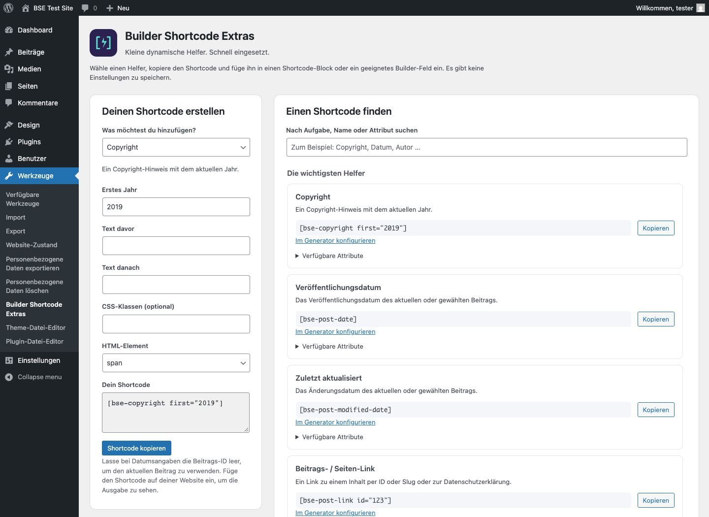

# Builder Shortcode Extras

[English](https://github.com/deckerweb/builder-shortcode-extras/wiki/English) · [Deutsch](https://github.com/deckerweb/builder-shortcode-extras/wiki/Deutsch)

**Kleine dynamische Helfer. Schnell eingesetzt.**

Copyright, Datumsangaben, Links und wiederverwendbare Inhalte ohne eigenes PHP. Mit einer durchsuchbaren Hilfe und einem kompakten Generator direkt in WordPress.

Version **1.2.1** · WordPress **6.7+** · PHP **8.0+**

## Erste Schritte

1. Lade das Plugin-ZIP aus den GitHub-Releases herunter.
2. Öffne Plugins → Installieren → Plugin hochladen und aktiviere es.
3. Öffne Werkzeuge → Builder Shortcode Extras, wähle einen Helfer und kopiere den Shortcode.
4. Füge ihn in einen Shortcode-Block oder ein geeignetes Builder-Feld ein und prüfe die Ausgabe.

BSE speichert keine Generatorwerte und verändert keine Inhalte.

## Plugin-Seite



## Beispiele

```text
[bse-copyright first="2019"]
[bse-post-date format="Y-m-d"]
[bse-post-modified-date label="Last updated: "]
[bse-post-link id="123" text="Read more"]
[bse-item-content id="123"]
```

## Shortcode-Referenz


| Shortcode | Attribute | Voraussetzung |
|---|---|---|
| `bse-nav-menu` | `before`, `after`, `class`, `wrapper`, `menu`, `container`, `container_class`, `container_id`, `menu_class`, `menu_id`, `fallback_cb`, `item_before`, `item_after`, `link_before`, `link_after`, `depth`, `walker`, `theme_location`, `items_wrap`, `item_spacing` | WordPress |
| `bse-item-content` | `id`, `css` | WordPress |
| `bse-comment-form` | `before`, `after`, `class`, `wrapper`, `post_id`, `id_form`, `class_form`, `title_reply`, `title_reply_to`, `cancel_reply_link`, `label_submit` | WordPress |
| `bse-elementor-template` | `id`, `css` | Elementor Free |
| `bse-genesis-footer` | `class`, `wrapper` | Genesis 3.1+ |
| `bse-genesis-breadcrumbs` | `class`, `wrapper` | Genesis 3.1+ |
| `bse-copyright` | `after`, `before`, `copyright`, `first`, `class`, `wrapper` | WordPress |
| `bse-site-title` | `after`, `before`, `class`, `wrapper` | WordPress |
| `bse-site-slogan` | `after`, `before`, `class`, `wrapper` | WordPress |
| `bse-home-link` | `after`, `before`, `text`, `target`, `rel`, `class`, `wrapper` | WordPress |
| `bse-loginout` | `after`, `before`, `login_text`, `logout_text`, `login_target`, `logout_target`, `login_redirect`, `logout_redirect`, `class`, `wrapper` | WordPress |
| `bse-site-updated` | `before`, `after`, `type`, `label_date`, `date_format`, `label_time`, `time_format`, `tooltip`, `class`, `wrapper` | WordPress |
| `bse-post-count` | `post_type`, `status`, `before`, `after`, `class`, `wrapper` | WordPress |
| `bse-post-date` | `after`, `before`, `post_id`, `format`, `label`, `relative_depth`, `class`, `wrapper` | WordPress |
| `bse-post-time` | `after`, `before`, `post_id`, `format`, `label`, `class`, `wrapper` | WordPress |
| `bse-post-modified-date` | `after`, `before`, `post_id`, `format`, `label`, `relative_depth`, `class`, `wrapper` | WordPress |
| `bse-item-last-updated` | `after`, `before`, `post_id`, `format`, `label`, `class`, `wrapper` | WordPress |
| `bse-post-modified-time` | `after`, `before`, `post_id`, `format`, `label`, `class`, `wrapper` | WordPress |
| `bse-post-author` | `after`, `before`, `class`, `wrapper` | WordPress |
| `bse-post-author-link` | `after`, `before`, `target`, `rel`, `class`, `wrapper` | WordPress |
| `bse-post-author-posts-link` | `after`, `before`, `target`, `rel`, `class`, `wrapper` | WordPress |
| `bse-post-tags` | `after`, `before`, `sep`, `class`, `wrapper` | WordPress |
| `bse-post-categories` | `sep`, `before`, `after`, `class`, `wrapper` | WordPress |
| `bse-post-terms` | `after`, `before`, `sep`, `taxonomy`, `class`, `wrapper` | WordPress |
| `bse-post-edit` | `after`, `before`, `label`, `class`, `wrapper` | WordPress |
| `bse-post-link` | `id`, `slug`, `post_type`, `privacy`, `text`, `target`, `rel`, `before`, `after`, `class`, `wrapper` | WordPress |
| `bse-user` | `user_id`, `field`, `default`, `before`, `after`, `class`, `wrapper` | WordPress |
| `bse-userid` |  | WordPress |
| `bse-email` |  | WordPress |
| `bse-login` |  | WordPress |
| `bse-displayname` |  | WordPress |
| `bse-firstname` |  | WordPress |
| `bse-lastname` |  | WordPress |
| `bse-version` | `type`, `plugin`, `constant`, `custom`, `before`, `after`, `class`, `wrapper` | WordPress |
| `bse-wpblock` | `id`, `css` | WordPress synced patterns |
| `bse-astra-layout` | `id`, `css` | Astra Pro custom layouts |


## Fragen nach Themen

### Einrichtung

#### Muss ich das Plugin konfigurieren?

Nein. Öffne Werkzeuge → Builder Shortcode Extras, um einen Shortcode zu finden oder zu erstellen. Die Seite speichert keine Einstellungen.

#### Wo füge ich einen Shortcode ein?

In einen WordPress-Shortcode-Block oder ein Builder-Feld mit ausdrücklicher Shortcode-Unterstützung. Beliebige Text-, URL- und HTML-Felder führen Shortcodes nicht automatisch aus.

#### Was kann der Generator erstellen?

Copyright, Veröffentlichungsdatum, Änderungsdatum, einen Beitrags-/Seiten-Link und Inhaltseinbettungen. Weitere Helfer findest du in der durchsuchbaren Übersicht.

#### Kann ich auf Deutsch suchen?

Ja. Oberfläche und Aufgabenbeschreibungen folgen der WordPress-Administrationssprache. Shortcode- und Attributnamen bleiben unverändert.

#### Wo finde ich eine Beitrags- oder Vorlagen-ID?

Öffne den Inhalt in WordPress. Die Zahl hinter post= in der Editor-Adresse ist seine ID. Unterstützte Vorlagenlisten zeigen zusätzlich Shortcode-Beispiele.

### Ausgabe und Integrationen

#### Auf welchen Beitrag bezieht sich ein Datum?

Ohne post_id auf den aktuellen WordPress-Beitrag. Gib eine ID für einen anderen Inhalt an. Der Kontext in einer Builder-Vorschau kann von der fertigen Seite abweichen.

#### Gibt es relative Datumsangaben?

Wähle Relatives Datum im Generator oder verwende format="relative". Die Ausgabe verwendet den vorhandenen Helfer für verstrichene Zeit.

#### Kann ich HTML und Klassen ändern?

Die meisten Texthelfer unterstützen wrapper, class, before und after. Mehrere Klassen sind möglich. Unsichere oder nicht unterstützte Wrapper werden durch span ersetzt. Diese Version ergänzt keinen Modus ohne Wrapper.

#### Werden Frontend-CSS oder JavaScript geladen?

Hilfe und Generator laden Ressourcen nur auf ihrer eigenen Admin-Seite. Eingebettete Builder-Vorlagen können Ressourcen ihres Builders laden; das Kommentarformular kann WordPress-Ressourcen benötigen.

#### Warum bleibt eine Inhaltseinbettung leer?

Prüfe ID, Veröffentlichungsstatus und erforderlichen Builder. Private, unveröffentlichte, gelöschte oder passwortgeschützte Inhalte werden Besuchern ohne erforderlichen Zugriff nicht ausgegeben. Rekursive Referenzen werden gestoppt.

#### Werden native Blöcke unterstützt?

Ja. Eingebettete Inhalte werden durch die native Block-Ausgabe und Shortcode-Verarbeitung geführt. Die vollständigen Inhaltsfilter des Themes werden bewusst nicht angewendet.

#### Brauche ich Elementor Pro?

bse-elementor-template wird bei Elementor Free ohne aktives Pro registriert. Der allgemeine Inhaltshelfer kann Elementor-Inhalte rendern, wenn Elementor verfügbar ist.

#### Bleibt Beaver Builder unterstützt?

Ja. Inhalte mit _fl_builder_enabled verwenden Beavers eigenen Layout-Shortcode. Die Installation von Beaver verändert die Ausgabe normaler Beiträge nicht. Zusätzliche Beaver-Funktionen wurden nicht ergänzt.

#### Bleibt Genesis unterstützt?

Ja. Die vorhandenen Footer- und Breadcrumb-Helfer bleiben mit Genesis 3.1+ als Kompatibilitätsfunktionen erhalten.

### Updates, Daten und Sicherheit

#### Funktionieren synchronisierte Vorlagen mit Classic Editor?

bse-wpblock ist verfügbar, sobald WordPress den Inhaltstyp wp_block registriert. Das zusätzliche alte Blocks-Menü entfällt.

#### Warum hat der Generator keine Live-Vorschau?

Der Generator erstellt die Syntax lokal. Prüfe die Ausgabe auf einer Seite im vorgesehenen Beitrags- und Builder-Kontext.

#### Wie funktioniert Kopieren ohne HTTPS?

Zuerst wird die Browser-Zwischenablage versucht, danach eine lokale Kopierfunktion. Ist beides nicht verfügbar, wird der Text zum manuellen Kopieren markiert. Beispiele bleiben ohne JavaScript lesbar.

#### Wie funktionieren Updates?

Der mitgelieferte deckerweb Updater prüft das öffentliche GitHub-Repository auf neuere stabile Releases über die normale WordPress-Updateverwaltung. Er installiert keine Vorabversionen automatisch und aktiviert keine automatischen Updates. Testversionen installierst du manuell.

#### Was ist die deckerweb Library?

Die eingebettete deckerweb Library ergänzt einen Katalog unter Plugins → Installieren → deckerweb. Ihre Optionen liegen unter Einstellungen → deckerweb Library, bei Multisite in den Netzwerkeinstellungen. Das Öffnen des Katalogs installiert nichts. Installation und Aktivierung sind getrennte Aktionen.

#### Sendet das Plugin Nutzungsdaten?

BSE enthält keine Nutzungstelemetrie. Der Updater fragt GitHub-Release-Metadaten ab. Die Library nutzt standardmäßig ihren lokalen Katalog; Online-Katalogupdates erfordern eine ausdrückliche Konfiguration. Server sehen technisch die anfragende IP-Adresse.

#### Was ändert sich für bestehende Installationen?

Namen, Aliase und Ausgabefilter bleiben. PHP 8.0 ist jetzt erforderlich. Ungültige Wrapper werden zu span, Text wird konsistenter escaped, unzugängliche Inhalte werden nicht eingebettet und die Admin-Registrierung folgt dem Opt-in-Filter.

#### Kann ich Texthelfer im Backend aktivieren?

Entwickler können über bse/filter/shortcodes_in_admin true zurückgeben. Inhaltseinbettungen, Navigation, Kommentarformulare sowie Builder-/Genesis-Ausgaben bleiben dort ausgeschlossen. REST-Anfragen bleiben für Frontend-Ausgaben verfügbar.

#### Funktioniert das Plugin mit Multisite?

BSE lässt sich je Website oder netzwerkweit aktivieren. Inhalts-IDs beziehen sich auf die aktuelle Website. Website-Administratoren verwenden Werkzeuge → Builder Shortcode Extras; Super-Administratoren zusätzlich Netzwerkeinstellungen → Builder Shortcode Extras. Die Library-Optionen gelten je Netzwerk.

#### Welche Anforderungen und welchen Support gibt es?

WordPress 6.7+ und PHP 8.0+. Die Library-Installation benötigt ZipArchive. Melde reproduzierbare Fehler auf GitHub mit Plugin-, WordPress-, PHP- und Builder-Version. Kommerzielle Builder wurden mit repräsentativen Testfällen geprüft, nicht mit lizenzierten Installationen.

#### Was passiert beim Entfernen mit den Daten?

BSE speichert keine Shortcode- oder Generator-Einstellungen. Deaktivierung erhält alle Daten. Deinstallation entfernt nur den temporären BSE-Updater-Cache und gibt die Library-Zuständigkeit frei. Andere installierte Library-Hosts schützen gemeinsame Daten, auch wenn sie deaktiviert sind. Der letzte Host entfernt temporäre Library-Daten; Optionen bleiben erhalten, außer die Löschoption der Library war aktiviert. Beiträge, Shortcodes, installierte Plugins und fremde Daten bleiben erhalten.

#### Kann der Versionshelfer Zugangsdaten anzeigen?

Nein. Shortcode-Attribute können Konstanten mit Namen auswählen, die auf VERSION oder VER enden. Andere Konstanten benötigen einen ausdrücklich gesetzten vertrauenswürdigen PHP-Standardfilter. Gib über Entwicklerfilter keine Installationsgeheimnisse frei.

#### Wie melde ich eine Sicherheitslücke?

Verwende Security → Advisories → Report a vulnerability im GitHub-Repository dieses Plugins. Nenne Plugin-, Library- und Umgebungsversionen und eine minimale Reproduktion ohne Zugangsdaten. Poste Sicherheitsdetails nicht in öffentlichen Issues. Siehe SECURITY.md.

## Entwickler

```php
add_filter( 'bse/filter/shortcodes_in_admin', '__return_true' );
```

Bestehende Filter unter `bse/filter/shortcode_defaults/*` und `bse/filter/shortcode/*` bleiben erhalten. PHP-Callbacks sind vertrauenswürdiger Entwicklercode und können HTML zurückgeben. Menüs verwenden einen sicheren Standard-Callback; eigene Callbacks werden nur durch PHP-Standardfilter konfiguriert.

[Changelog](https://github.com/deckerweb/builder-shortcode-extras/wiki/CHANGELOG%E2%80%90de) · [Security](https://github.com/deckerweb/builder-shortcode-extras/security/advisories/new)
